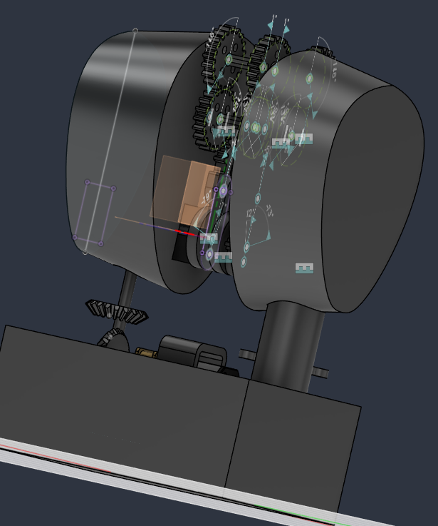

This is a 3D printable model for a DC motor powered mechanical dragonfly with moving wings.

So far only the thorax has been done, but its the only section with moving parts so other sections can easily be modeled.

Wings can be cut from a more lightweight material like cloths+wires, paper, or cardboard.

